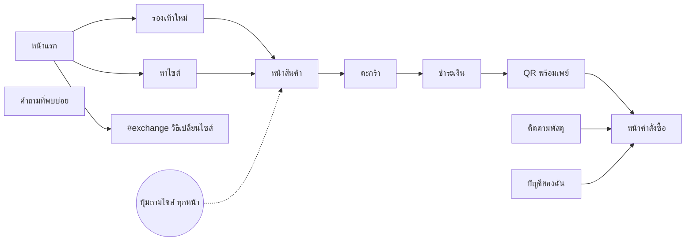
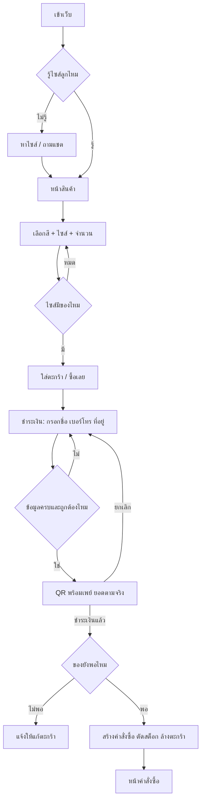
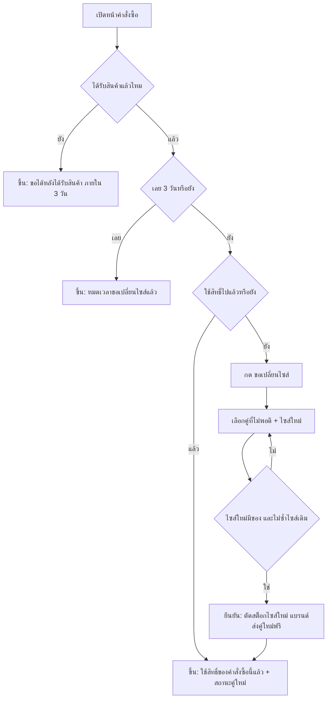
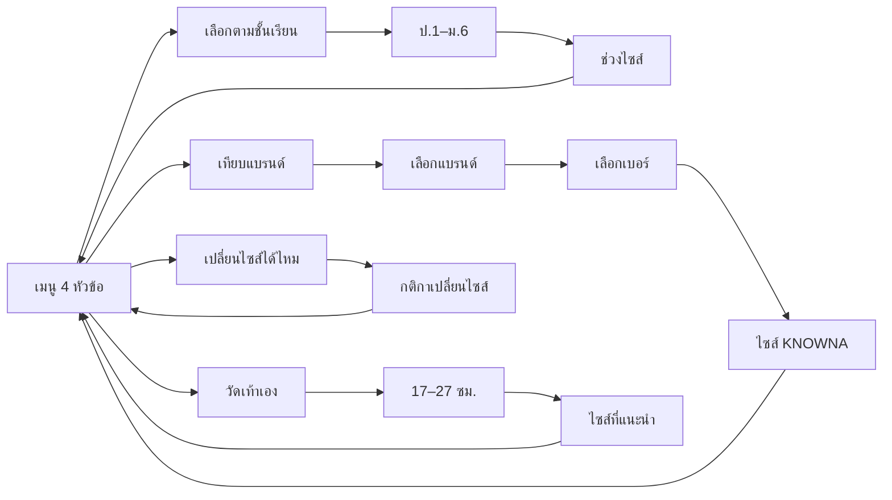

# Flow การทำงานของเว็บไซต์ KNOWNA

เว็บต้นแบบร้านรองเท้าผ้าใบนักเรียนชาย KNOWNA (รายวิชา ITDS294)
เว็บไซต์: https://newn26.github.io/Knowna/

> เว็บสาธิต: ไม่มีเซิร์ฟเวอร์จริง ข้อมูลเก็บในเบราว์เซอร์ของผู้ใช้ (localStorage)
> การชำระเงินและการส่ง SMS เป็นการจำลอง ภาพสินค้าสร้างด้วย AI

## 1. ผู้ใช้งาน

| ผู้ใช้ | บทบาท |
|---|---|
| ผู้ปกครอง | ผู้ซื้อ เลือกไซส์ ชำระเงิน ติดตามพัสดุ ขอเปลี่ยนไซส์ |
| นักเรียนชาย ป.1–ม.6 | ผู้สวมใส่ (กลุ่มเป้าหมายของแบรนด์) |

## 2. ข้อมูลหลักของร้าน (ตามรายงาน)

| เรื่อง | ค่า |
|---|---|
| สินค้า | KNOWNA Classic รองเท้าผ้าใบนักเรียนชาย 3 สี: ดำ ขาว น้ำตาล |
| ราคา | 259 บาทต่อคู่ รวมค่าจัดส่งแล้ว |
| ไซส์ | EU 28–45 (ป.1–ม.6) |
| ช่องทางขาย | เว็บไซต์ของแบรนด์เท่านั้น ไม่มีหน้าร้าน |
| ชำระเงิน | พร้อมเพย์ (QR) ผ่านระบบรับชำระเงิน Omise |
| เปลี่ยนไซส์ | ฟรี 1 ครั้งต่อคำสั่งซื้อ ภายใน 3 วันหลังได้รับสินค้า แบรนด์ออกค่าส่งคู่ใหม่ |
| ช่วยเลือกไซส์ | คู่มือวัดเท้า, ตารางเทียบไซส์กับแบรนด์อื่น, แชตแนะนำไซส์ |
| แจ้งเตือน | เก็บไซส์เท้าลูก แจ้งเตือนก่อนเปิดเทอม (1 เมษายน) |

## 3. แผนผังหน้าเว็บ

| หน้า | ที่อยู่ | ใช้ทำอะไร |
|---|---|---|
| หน้าแรก | `#/` | จุดเด่นของแบรนด์ ราคา วิธีเปลี่ยนไซส์ เลือกชั้นเรียนดูไซส์ |
| รองเท้าใหม่ | `#/shop` | รองเท้า 3 สี กรองตามสีและไซส์ |
| หน้าสินค้า | `#/product` | รูปสินค้า เลือกสี ไซส์ จำนวน ตารางไซส์ ใส่ตะกร้า/ซื้อเลย |
| หาไซส์ | `#/size` | 3 วิธีหาไซส์ และตารางไซส์เต็ม |
| ตะกร้า | `#/cart` | แก้จำนวน ลบสินค้า สรุปยอด |
| ชำระเงิน | `#/checkout` | กรอกผู้รับและที่อยู่ จ่ายด้วย QR พร้อมเพย์ |
| คำสั่งซื้อ | `#/order/:id` | สถานะจัดส่ง ขอเปลี่ยนไซส์ |
| ติดตามพัสดุ | `#/track` | ค้นด้วยเลขคำสั่งซื้อ + เบอร์โทร |
| บัญชีของฉัน | `#/account` | ประวัติการซื้อ รองเท้าของฉัน ไซส์เท้าลูก แจ้งเตือน |
| คำถามที่พบบ่อย | `#/help` | ราคา ไซส์ ชำระเงิน จัดส่ง เปลี่ยนไซส์ |

## 4. Flow ที่ 1: ซื้อรองเท้า

1. เลือกสีและไซส์ ไซส์ที่หมดกดไม่ได้ ไซส์ที่เหลือน้อยมีตัวเลขบอกจำนวน
2. ตะกร้าคิดยอดเป็น 259 × จำนวน และแสดงค่าจัดส่งว่า "รวมในราคาแล้ว"
3. หน้าชำระเงินตรวจข้อมูลทุกช่อง เช่น เบอร์โทร 9–10 หลักขึ้นต้นด้วย 0 และรหัสไปรษณีย์ 5 หลัก
4. กด "ยืนยันคำสั่งซื้อ และชำระเงิน" แล้ว QR พร้อมเพย์จะเด้งขึ้นมาพร้อมยอดเงิน
5. กด "ชำระเงินแล้ว" (จำลอง) ระบบตรวจสต็อกอีกครั้ง แล้วสร้างคำสั่งซื้อเลข `KN-ปปดดวว-xxxx`

**สถานะคำสั่งซื้อ:** รับคำสั่งซื้อ → แพ็กสินค้า → กำลังจัดส่ง → ส่งถึงแล้ว
(ในเว็บสาธิต คำสั่งซื้อใหม่จะขยับสถานะเองทุกประมาณ 30 วินาที และถึงมือภายในประมาณ 2 นาที)

## 5. Flow ที่ 2: เปลี่ยนไซส์ฟรี

กติกาที่ระบบบังคับ:
- 1 ครั้งต่อคำสั่งซื้อ ไม่ใช่ต่อคู่ ใช้แล้วปุ่มจะหายไป
- ขอได้เฉพาะหลังได้รับสินค้าแล้ว และภายใน 3 วัน
- ไซส์ใหม่ต้องต่างจากเดิม และต้องมีของ

**สถานะการเปลี่ยนไซส์:** รับคำขอเปลี่ยนไซส์ → ส่งคู่ใหม่แล้ว → คู่ใหม่ส่งถึงแล้ว

## 6. Flow ที่ 3: ช่วยเลือกไซส์

| วิธี | อยู่ที่ไหน | ผู้ใช้ทำอะไร | ได้อะไร |
|---|---|---|---|
| ตามชั้นเรียน | หน้าแรก, หาไซส์ | กดชั้น ป.1–ม.6 | ช่วงไซส์ที่เด็กชั้นนั้นใส่ |
| วัดความยาวเท้า | หาไซส์ | เลื่อนความยาวเท้า (ซม.) เผื่อโต +0.5 ซม. | ไซส์เดียวที่แนะนำ + ปุ่มซื้อ |
| เทียบแบรนด์ | หาไซส์ | เลือกแบรนด์ (นันยาง, Breaker, Gold City, Tiger) และเบอร์ที่ใส่ | ไซส์ KNOWNA ที่เทียบเท่า |
| แชตถามไซส์ | ปุ่มมุมขวาล่างทุกหน้า | กดตัวเลือก หรือพิมพ์เอง | ไซส์ที่แนะนำ + ลิงก์ไปหน้าสินค้า |

เส้นทางในแชต (กดได้ทั้งหมด ไม่ต้องพิมพ์):

## 7. Flow ที่ 4: บัญชี ไซส์เท้าลูก และแจ้งเตือน

1. เข้าสู่ระบบด้วยบัญชีเดโม (คุณนภา)
2. เห็น "รองเท้าของฉัน" ทุกคู่ที่เคยซื้อ และประวัติคำสั่งซื้อ
3. "ไซส์เท้าลูก": เพิ่มชื่อเล่น ชั้น และความยาวเท้า แล้วระบบคำนวณไซส์ให้ ถ้าวัดไว้นานเกิน 6 เดือนจะเตือนให้วัดใหม่
4. "แจ้งเตือนก่อนเปิดเทอม": เปิด/ปิดได้ ส่งครั้งถัดไปวันที่ 1 เมษายน ก่อนช่วงเปิดเทอมเมษายน–พฤษภาคม (จำลอง ไม่ส่ง SMS จริง)

ผู้ที่ไม่มีบัญชียังเห็นคำสั่งซื้อที่สั่งจากเครื่องนั้น และติดตามพัสดุได้ด้วยเลขคำสั่งซื้อ + เบอร์โทร

## 8. ลำดับสาธิตให้อาจารย์ดู (ประมาณ 5 นาที)

1. หน้าแรก: ชี้ราคา 259 บาท รวมค่าส่ง และจุดขาย "ไซส์ผิด เปลี่ยนฟรี"
2. กด "ถามไซส์" → เทียบกับแบรนด์ที่ลูกใส่อยู่ → นันยาง → 36 → ดูรองเท้าเบอร์ 36
3. เลือกสีดำ → ซื้อเลย → กด "กรอกข้อมูลตัวอย่าง" → QR พร้อมเพย์ → ชำระเงินแล้ว → หน้าคำสั่งซื้อ
4. บัญชีของฉัน → เข้าสู่ระบบเดโม → เปิดคำสั่งซื้อที่ได้รับเมื่อวาน → ขอเปลี่ยนไซส์ 33 → 34 → ปุ่มหายไป (ใช้สิทธิ์แล้ว)
5. เปิดคำสั่งซื้อเก่า → ขึ้น "หมดเวลาขอเปลี่ยนไซส์แล้ว" (เกิน 3 วัน)
6. ไซส์เท้าลูก + แจ้งเตือนก่อนเปิดเทอม
7. คำถามที่พบบ่อย

ข้อมูลตัวอย่างสำหรับติดตามพัสดุ: `KN-250502-0107` + `0812345678`
ล้างข้อมูลเดโม: ลิงก์ "รีเซ็ตข้อมูลเดโม" ท้ายเว็บ

## 9. ข้อจำกัดของต้นแบบ

| เรื่อง | ในต้นแบบ | ระบบจริง |
|---|---|---|
| ข้อมูล | เก็บในเบราว์เซอร์แต่ละเครื่อง | ฐานข้อมูลบนเซิร์ฟเวอร์ (`src/lib/api.ts` แยกไว้ให้เปลี่ยนเป็น API ได้) |
| ชำระเงิน | QR จำลอง กด "ชำระเงินแล้ว" เอง | QR จริงจาก Omise ยืนยันผ่าน webhook |
| แชต | ตอบอัตโนมัติจากกฎไซส์ | เจ้าหน้าที่ตอบ |
| แจ้งเตือน | แสดงวันส่งครั้งถัดไป ไม่ส่งจริง | ส่ง SMS/LINE ตามวันที่ตั้ง |
| ตารางเทียบแบรนด์, ไซส์ ม.1–ม.6 | ตัวเลขตัวอย่าง | วัดจากรองเท้าจริง |
| ยังรอข้อมูลจากรายงาน | ค่าส่งคู่เดิมกลับ, ต้องส่งคู่เดิมคืนก่อนหรือไม่ | — |

## 10. การทดสอบ

- `npm test`: 11 เทสต์ ครอบคลุมราคา ไซส์ แชต วันแจ้งเตือน การสั่งซื้อ และกติกาเปลี่ยนไซส์ (1 ครั้ง, ภายใน 3 วัน, ไซส์ต้องต่างจากเดิม)
- ทดสอบในเบราว์เซอร์ (Brave) กดผ่านทุกหน้าและทุกปุ่ม 57 จุด ผ่านครบทั้งจอกว้าง 1280 และ 1440 ไม่มี error
